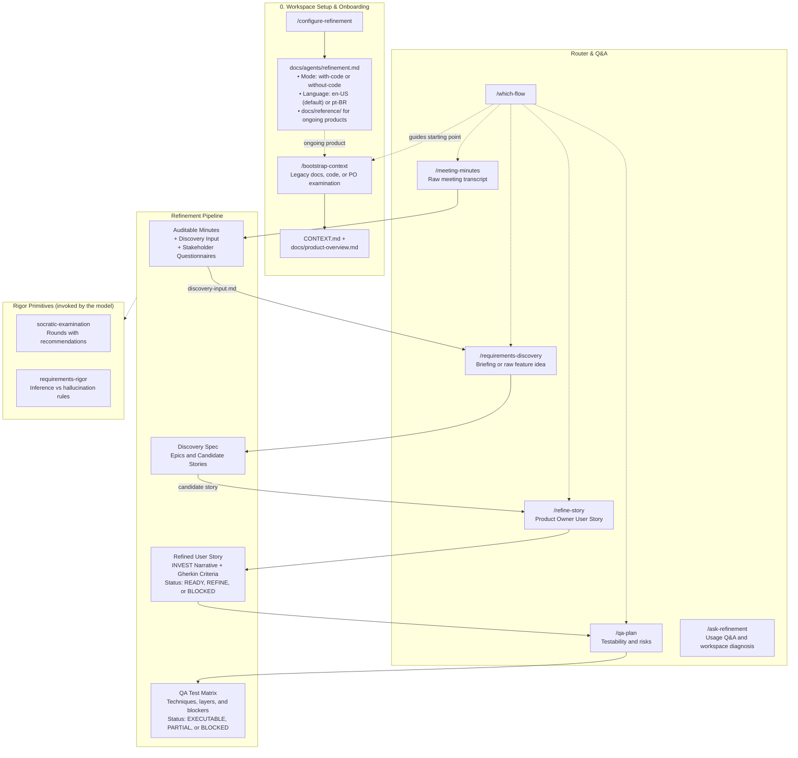

# Refinement Skills

[](LICENSE)
[](skills/)
[%20%7C%20pt--BR-green)](#two-modes-and-two-languages)

Agent skills for software requirements refinement: from meeting transcripts to QA test plans, driven by **socratic examination** (sabatina). The AI agent interviews the Product Owner in structured rounds with recommended answers, leaving no silent assumptions behind. Only then does it synthesize and publish. Nothing is invented: statements without backing become questions, and unanswered points are marked as explicit gaps and routed to questionnaires for stakeholders.

The package is self-contained: every skill invoked across the workflow lives directly in this repository.

> **New here or adopting on an ongoing (brownfield) product?** Read the **[Getting Started Guide (en-US)](docs/getting-started.md)** or **[Guia de Início Rápido (pt-BR)](docs/getting-started.pt-BR.md)** for workspace anatomy, brownfield context bootstrapping (`docs/reference/` + `/bootstrap-context`), and keeping platform Memory / Knowledge Base files updated in chat mode.

---

## Workflow Infographic

The diagram below shows how each skill connects across the refinement lifecycle, from initial meeting discussions to automated QA test plans:



Start at any point in the workflow. A User Story written by the PO can jump directly into `/refine-story`. Each workflow publishes its output to `.scratch/` so subsequent steps can consume it in a separate session. Use `/which-flow` if you are unsure where to begin.

---

## Daily Quick Reference

| Command | What you provide | What the agent delivers | Next step |
| --- | --- | --- | --- |
| `/configure-refinement` | None (interactive conversation) | Configured `refinement.md`, `docs/reference/` (ongoing products with docs), tracker rules, and agent instructions | `/bootstrap-context` or `/which-flow` |
| `/bootstrap-context` | Docs in `docs/reference/`, codebase, or PO answers | Curated `CONTEXT.md`, `docs/product-overview.md`, optional ADRs, and stakeholder questionnaires | `/refine-story` or `/requirements-discovery` |
| `/meeting-minutes` | Meeting transcript or text | Auditable minutes with provenance, action items, and discovery input | `/requirements-discovery` |
| `/requirements-discovery` | Briefing, notes, or `discovery-input.md` | Sized epics and candidate stories (`spec.md` or decision map) | `/refine-story` |
| `/refine-story` | Text, file path, or ID of a User Story | Refined US with Gherkin criteria and INVEST verdict | `/qa-plan` |
| `/qa-plan` | Refined User Story | QA test matrix mapped by technique, risk, and testing layers | Sprint planning |
| `/which-flow` | Description of your current input material | Recommendation of the right command to use | Recommended flow |
| `/ask-refinement` | Question about workflows, markers, files, or empty input | Direct answer, workspace diagnosis, and exact next command | Recommended command |

---

## How Socratic Examination Works

Unlike traditional AI prompts that invent details or generate long specs in a single blind shot, Refinement Skills conducts a **structured examination in rounds**:

1. **Facts belong to the agent:** before asking anything, the agent checks the glossary (`CONTEXT.md`), ADRs, previous stories, and, in code mode, inspects the codebase directly via subagents.
2. **Decisions belong to the PO:** scope, business value, and prioritization are strictly decided by the Product Owner.
3. **Recommended answers:** every question includes a grounded recommendation (`[INFERENCE: base]`). The PO can accept it with a single word or pick an alternative.
4. **No silent hallucinations:** rules or constraints without evidence become explicit questions or visible markers (`[TO CONFIRM: whom]`).

### Example of an interactive examination round

```text
❓ Q1. Who exports the report? (blocking)
The narrative says "user". The domain glossary lists operations analyst and account manager. Which role exports, or both?
Recommendation: operations analyst [INFERENCE: role associated with operational reports in CONTEXT.md].

❓ Q2. What is the maximum acceptable download timeout? (blocking)
The criterion states "fast", which is not testable. What is the maximum time in seconds?
Recommendation: no recommendation (the text provides no baseline for SLA numbers). Suggested options: 3s, 5s, or 10s.
```

---

## Two Modes and Two Languages

### Operating Modes

| | Without Code (`without-code`) | With Code (`with-code`) |
| --- | --- | --- |
| Target Audience | Product Owners, business analysts, QA engineers | Engineering, QA, and product teams with local repo checkouts |
| Source of Truth | `CONTEXT.md`, previous stories, documents in `docs/` | All workspace files plus read-only source code via subagent (in-repo or external local repo paths) |
| Technical Questions | Exported as questionnaires for developers | Answered by reading the code directly |
| Where to install | Dedicated product analysis workspace | The product codebase repository, or a dedicated refinement workspace pointing `Fact sources` to one or more local repositories (exposed via Multi-root workspace folders or `claude --add-dir <path>`) |

### Supported Languages

- **en-US (default):** socratic examination in English, narrative format "As a [role], I want [capability], so that [outcome]", Gherkin criteria with `Given/When/Then`, verdicts `READY`, `REFINE`, `BLOCKED`.
- **pt-BR:** socratic examination in Portuguese, narrative format "Como [papel], quero [capacidade], para que [resultado]", Gherkin criteria with `Dado/Quando/Então`, verdicts `PRONTA`, `REFINAR`, `BLOQUEADA`.

Operating mode and language are saved in `docs/agents/refinement.md` during `/configure-refinement`.

---

## Usage in Chat and Prompt-Based Agents

`node scripts/build-prompts.mjs` generates two prompt distributions under [prompts/](prompts/) from `skills/` for teams working without a local repository:

- **Unified web workspace ([prompts/project/](prompts/project/)):** paste `prompts/project/INSTRUCTIONS.md` into the System Prompt / Custom Instructions field of a Claude Project, ChatGPT Project, Custom GPT, Gemini Gem, or Copilot Studio agent, and upload `prompts/project/refinement-core.md` plus the five lean workflow files in `prompts/project/` to the Knowledge Base alongside `CONTEXT.md`, `product-overview.md`, and ADRs. All five workflows, automatic routing, and single-turn Q&A coexist in one shared workspace (using six package Knowledge Base slots with zero duplicated primitives), and starting a new conversation inside that same workspace resets chat history like `/clear` while keeping Knowledge Base files shared.
- **Ad-hoc single chat (`prompts/*.md`):** self-contained single-file prompts at the root of `prompts/` for pasting directly into plain web chats without persistent instructions or a shared Knowledge Base.

In both setups, examination workflows emit copy-ready **Memory / Knowledge Base Updates** blocks at final synthesis whenever new domain terms, baseline rules, or ADRs are resolved. See [Getting Started](docs/getting-started.md#4-web-agent-platforms-without-a-local-repository-promptsproject-vs-promptsmd).

---

## Workspace Installation and Setup

### 1. Install the skills

Choose the method that matches your environment:

- **Via Claude Code Plugin:**
  ```text
  /plugin marketplace add RafaelFerSilva/refinement-agent-skills
  /plugin install refinement-skills@refinement-skills
  ```

- **Via Agent Skills CLI (`npx skills`):**
  ```bash
  npx skills add RafaelFerSilva/refinement-agent-skills
  ```

- **Via Direct One-Liner (curl):**
  Install globally for all projects on your machine (`~/.claude/skills` and `~/.agents/skills`):
  ```bash
  curl -fsSL https://raw.githubusercontent.com/RafaelFerSilva/refinement-agent-skills/main/scripts/install.sh | bash
  ```
  Or install locally in your current workspace:
  ```bash
  curl -fsSL https://raw.githubusercontent.com/RafaelFerSilva/refinement-agent-skills/main/scripts/install.sh | bash -s -- --local
  ```

- **Via Local Git Clone:**
  ```bash
  git clone https://github.com/RafaelFerSilva/refinement-agent-skills.git
  cd refinement-agent-skills
  ./scripts/install.sh --global
  ```

### 2. Configure the workspace

Open your AI coding assistant inside your target project and run:

```text
/configure-refinement
```

The interactive skill guides you through:
1. **Operating mode:** `with-code` (agent inspects source code read-only in `.` or at local repository paths listed in `Fact sources`, such as `../product-api` and `../product-web`) or `without-code` (technical questions become questionnaires); legacy `com-codigo` and `sem-codigo` remain accepted on read.
2. **Language:** `en-US` (default) or `pt-BR`.
3. **Issue tracker:** base URL and prefix for task cards (Azure DevOps, Jira, GitHub Issues, etc.).
4. **Generated files:**
   - `docs/agents/refinement.md`: mode, language, and refinement rules.
   - `docs/agents/issue-tracker.md`: identifier conventions and links.
   - Adds the `## Refinement` section to `AGENTS.md` or `CLAUDE.md`.

Once configured, run `/which-flow` to pick your first step.

### 3. Update the skills

Use the command matching how you installed the package:

- **Via Claude Code Plugin:**
  From your terminal:
  ```bash
  claude plugin marketplace update refinement-skills
  claude plugin update refinement-skills@refinement-skills
  ```
  Or inside an active Claude Code session, run `/plugin`, open the **Marketplaces** tab, select `refinement-skills`, and choose **Update marketplace** (then run `/reload-plugins` or start a new session).

- **Via Agent Skills CLI (`npx skills`):**
  Update only the skills from this package:
  ```bash
  npx skills update which-flow ask-refinement bootstrap-context meeting-minutes requirements-discovery refine-story qa-plan configure-refinement socratic-examination requirements-rigor
  ```
  (Add `-g` for global scope, `-p` for project scope, or `-y` for non-interactive mode. To also pick up newly added skills from this repository, re-run `npx skills add RafaelFerSilva/refinement-agent-skills`.)

- **Via Direct One-Liner (curl):**
  Re-run the same `curl` command (it runs `git pull` inside `~/.refinement-skills` and refreshes symlinks), or run `git -C ~/.refinement-skills pull`.

- **Via Local Git Clone:**
  Run `git pull` inside the cloned repository; symlinks created by `./scripts/install.sh` point directly to `skills/` and update in place.

---

## Skills Catalog

**User-Invoked Workflows**

- [bootstrap-context](skills/bootstrap-context/SKILL.md): builds `CONTEXT.md` and `docs/product-overview.md` for ongoing products from existing docs, code, or a short PO examination.
- [meeting-minutes](skills/meeting-minutes/SKILL.md): turns meeting transcripts into auditable minutes, JSON action items, and discovery input.
- [requirements-discovery](skills/requirements-discovery/SKILL.md): transforms raw briefs and notes into epics and candidate user stories.
- [refine-story](skills/refine-story/SKILL.md): refines a User Story through examination until it earns a READY, REFINE, or BLOCKED verdict.
- [qa-plan](skills/qa-plan/SKILL.md): creates test conditions with declared design techniques, risk levels, test layers, and blockers.

**User-Invoked Support Skills**

- [which-flow](skills/which-flow/SKILL.md): router skill that identifies the right workflow for your input.
- [ask-refinement](skills/ask-refinement/SKILL.md): read-only Q&A and workspace diagnostic helper that explains workflows, markers, verdicts, and next steps.
- [configure-refinement](skills/configure-refinement/SKILL.md): configures workspace mode, language, tracker, and instructions.

**Model-Invoked Primitives**

- [socratic-examination](skills/socratic-examination/SKILL.md): the underlying examination engine: rounds, decision trees, recommendations with cited evidence, and live glossary updates.
- [requirements-rigor](skills/requirements-rigor/SKILL.md): the shared rules of rigor: inference vs hallucination, markers, INVEST criteria, Gherkin standards, and questionnaire templates.

---

## Guia em Português

Consulte o **[Guia de Início Rápido completo em Português](docs/getting-started.pt-BR.md)** para ver a estrutura de pastas do workspace, como iniciar em projetos novos vs. projetos já em andamento (`docs/reference/` + `/bootstrap-context`), como configurar um workspace web unificado (`prompts/project/`) vs. chats avulsos (`prompts/*.md`) e como manter a Memória / Base de Conhecimento sincronizada.

Resumo rápido para utilizar o fluxo em português:

1. Instale o pacote usando um dos comandos acima.
2. No seu repositório, execute `/configure-refinement` e selecione o idioma `pt-BR`.
3. Em projetos já em andamento, coloque a documentação existente em `docs/reference/` (opcional) e execute `/bootstrap-context` para gerar o `CONTEXT.md` e o `docs/product-overview.md` antes da primeira US.
4. O agente conduzirá as perguntas em português, produzirá narrativas no padrão "Como [papel], quero [capacidade], para que [resultado]", critérios com `Dado/Quando/Então`, marcadores como `[INFERÊNCIA: base]` e vereditos `PRONTA`, `REFINAR` ou `BLOQUEADA`.

---

## Development and Testing

- `node scripts/validate-skills.mjs`: verifies frontmatter, plugin manifest, router consistency, self-containment, and prompt freshness.
- `node scripts/build-prompts.mjs`: rebuilds self-contained `prompts/*.md` and modular `prompts/project/*.md` files from `skills/`.
- `node scripts/grade-output.mjs`: runs mechanical assertions on published refinement artifacts in `en-US` and `pt-BR`.
- `node scripts/aggregate-runs.mjs`: aggregates multi-run `grading.json` results against the pass-rate threshold and compares against `no_skill` baselines.
- `node scripts/diff-glossary.mjs`: checks whether an examination session modified or duplicated existing `CONTEXT.md` definitions without a confirmation marker.
- `claude plugin validate . --strict`: validates plugin manifest.
- `git config core.hooksPath .githooks`: enables the pre-commit hook that runs the three Definition of Done checks before each commit.
- `scripts/link-skills.sh`: symlinks `skills/*` into local CLI skill folders for dogfooding inside this repository.
- `scripts/install.sh`: fast installer script for local and remote setups.
- `evals/`: evaluation suites and fixtures following the Anthropic `skill-creator` format (see [evals/README.md](evals/README.md)).

Contributor guidelines are detailed in [AGENTS.md](AGENTS.md); project vocabulary in [CONTEXT.md](CONTEXT.md); architectural decisions in [docs/adr/](docs/adr/).

---

## License

[MIT](LICENSE). Free and open-source software for the community.
