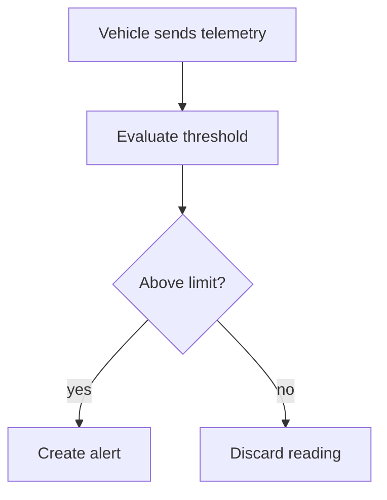

# Discovery: speed alerts

Status: in progress
Azure: 200
Source: evals/fixtures/briefing-alertas-velocidade.md, /requirements-discovery session on 2026-04-18

## Target Outcome

A backlog of candidate stories covering speed alert detection, notification, and closure for the fleet MVP.

## Domains

| Domain | Description | Confidence |
| --- | --- | --- |
| Telemetry | Vehicle position and speed ingestion | High |
| Alerting | Threshold evaluation and alert lifecycle | High |
| Notification | Delivery to dispatch operators | Low |

## Stakeholders

| Name or role | Type | Advocates for | Conflicts |
| --- | --- | --- | --- |
| Carlos, operations director | business | alerts in the MVP | none |
| Priya, IT | technical | SAP integration out of the MVP | [CONFLICT] with Carlos on MVP scope |

## Epics

| Epic | Description | Complexity | Rationale | Domain |
| --- | --- | --- | --- | --- |
| Speed alert detection | Evaluate telemetry against thresholds | M | one rule, one data source | Alerting |
| Alert notification | Deliver alerts to operators | L | channel undefined | Notification |

## Examination Decisions

- Which threshold triggers an alert? -> road speed limit plus tolerance defined per route (PO, 2026-04-18)

## Open Questions

1. [PO] Which notification channel does the MVP require? -> sizes the notification epic (questionnaire: none)
2. [DEV] Does the telemetry vendor expose a push API? -> defines detection latency (questionnaire: questionnaire-dev.md)

## Undeclared Dependencies

- Telemetry vendor API -> blocks speed alert detection -> confirm contract and SLA with vendor

## Out of Scope

- SAP integration -> [CONFLICT] unresolved, treated as a separate project

## Primary Flow by Epic

## Candidate Stories

- `issues/01-detect-speed-alert.md`: As a dispatch operator, I want speed alerts created automatically. INVEST: PASS across all
- `issues/02-notify-operator.md`: As a dispatch operator, I want to be notified of a new alert. INVEST: FAIL on T

> ⚠️ This output is an analytical draft. It requires human review before entering a sprint. Validate: technical feasibility, compliance, and unmapped dependencies.
