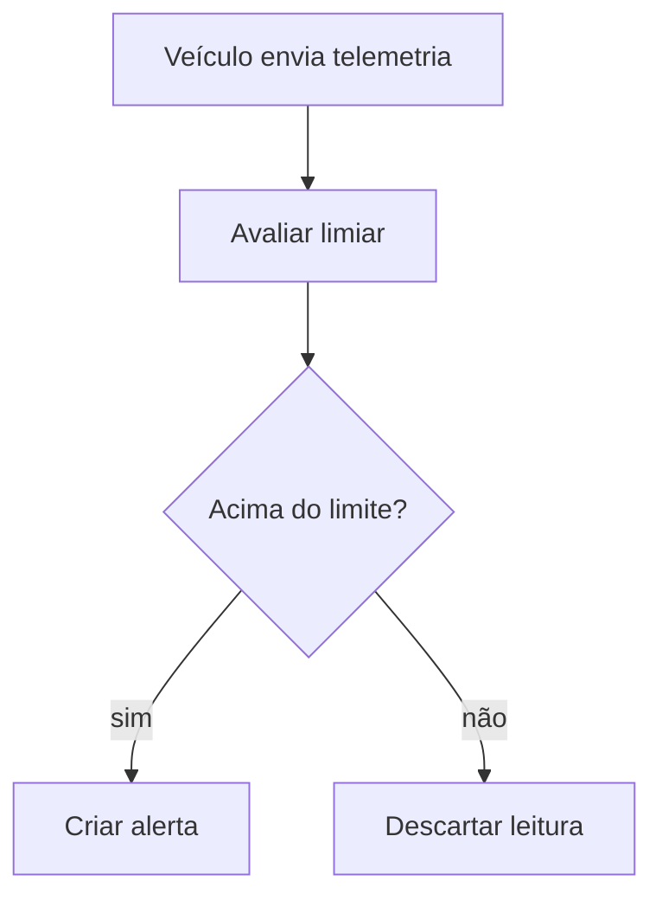

# Discovery: alertas de velocidade

Status: em andamento
Azure: 200
Fonte: evals/fixtures/briefing-alertas-velocidade.md, sessão /requirements-discovery em 2026-04-18

## Resultado alvo

Um backlog de histórias candidatas cobrindo detecção, notificação e encerramento de alertas de velocidade para o MVP da frota.

## Domínios

| Domínio | Descrição | Confiança |
| --- | --- | --- |
| Telemetria | Ingestão de posição e velocidade dos veículos | Alta |
| Alertas | Avaliação de limiar e ciclo de vida do alerta | Alta |
| Notificação | Entrega aos operadores de despacho | Baixa |

## Stakeholders

| Nome ou papel | Tipo | Defende | Conflitos |
| --- | --- | --- | --- |
| Carlos, diretor de operações | negócio | alertas no MVP | nenhum |
| Priya, TI | técnico | integração SAP fora do MVP | [CONFLITO] com Carlos no escopo do MVP |

## Épicos

| Épico | Descrição | Complexidade | Motivo | Domínio |
| --- | --- | --- | --- | --- |
| Detecção de alerta de velocidade | Avaliar telemetria contra limiares | M | uma regra, uma fonte de dados | Alertas |
| Notificação de alerta | Entregar alertas aos operadores | G | canal indefinido | Notificação |

## Decisões da sabatina

- Qual limiar dispara um alerta? -> limite da via mais tolerância definida por rota (PO, 2026-04-18)

## Perguntas em aberto

1. [PO] Qual canal de notificação o MVP exige? -> dimensiona o épico de notificação (questionário: nenhum)
2. [DEV] O fornecedor de telemetria expõe API de push? -> define a latência de detecção (questionário: questionario-dev.md)

## Dependências não declaradas

- API do fornecedor de telemetria -> bloqueia a detecção de alerta de velocidade -> confirmar contrato e SLA com o fornecedor

## Fora de escopo

- Integração SAP -> [CONFLITO] não resolvido, tratado como projeto separado

## Fluxo principal por épico

## Histórias candidatas

- `issues/01-detectar-alerta-velocidade.md`: Como operador de despacho, quero alertas de velocidade criados automaticamente. INVEST: PASS em todos
- `issues/02-notificar-operador.md`: Como operador de despacho, quero ser notificado de um alerta novo. INVEST: FAIL em T

> ⚠️ Esta saída é um rascunho analítico. Exige revisão humana antes de entrar em sprint. Valide: viabilidade técnica, conformidade e dependências não mapeadas.
